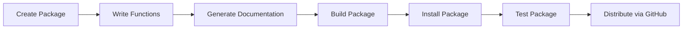

# EXPERIMENT 11: Writing R Packages

<div align="center">

[](https://github.com/RAVIKUMARSONI24ai/StudentPackage)
[](https://github.com/RAVIKUMARSONI24ai/StudentPackage)
[](https://opensource.org/licenses/MIT)
[](https://github.com/RAVIKUMARSONI24ai/StudentPackage)

</div>

---

## 🎯 Aim
To understand the internal structure of an R package and develop a custom R package for code reusability, standard documentation, automated testing, and distribution via GitHub.

---

## 📖 Theory
As software and data analysis projects grow larger, managing hundreds of isolated scripts becomes error-prone and unmaintainable. To solve this problem, R provides **packages** that bundle functions, documentation, datasets, unit tests, and metadata into a standardized, reusable unit.

An R package is a structured collection of:
- **Functions**: Reusable R code located in `R/`.
- **Datasets**: Sample datasets in `data/`.
- **Documentation**: Standardized manual pages (`.Rd` files) in `man/`.
- **Tests**: Automated unit tests in `tests/testthat/`.
- **Metadata**: Machine- and human-readable metadata in `DESCRIPTION` and `NAMESPACE`.

### Advantages of Packages
- **Reusability**: Write functions once and invoke them across any project without `source()` calls.
- **Maintainability**: Clear separation of concerns, modular code, and automated unit testing.
- **Easy Distribution**: Distribute via CRAN, GitHub, or local repositories.
- **Collaboration**: Standardized conventions allow open-source teams to contribute seamlessly.

---

## 📁 Structure of `StudentPackage`

```
StudentPackage/
├── DESCRIPTION               # Package metadata (Name, Version, Author, Dependencies)
├── NAMESPACE                 # Exported functions and imported dependencies
├── LICENSE                   # MIT License
├── README.md                 # Lab manual, documentation & GitHub guide
├── push_to_github.bat        # Batch automation script for git sync
├── run_experiment.R          # Master verification & demonstration script
├── R/                        # Source code for all R functions
│   ├── addNumbers.R          # Core function: addNumbers(a, b)
│   ├── subtractNumbers.R     # Exercise 3: subtractNumbers(a, b)
│   ├── multiplyNumbers.R     # Exercise 3: multiplyNumbers(a, b)
│   ├── calculator.R          # Exercise 1: add(), subtract(), multiply(), divide()
│   └── stats.R               # Exercise 2: mean_value(), variance(), std_dev()
├── man/                      # roxygen2 generated documentation (.Rd files)
│   ├── addNumbers.Rd
│   ├── add.Rd
│   ├── subtract.Rd
│   ├── multiply.Rd
│   ├── divide.Rd
│   ├── mean_value.Rd
│   ├── variance.Rd
│   ├── std_dev.Rd
│   ├── subtractNumbers.Rd
│   └── multiplyNumbers.Rd
└── tests/                    # testthat unit testing framework
    ├── testthat.R
    └── testthat/
        └── test-operations.R
```

---

## 🔄 Package Development Life Cycle



1. **Create Package**: Initialize package structure (`create("StudentPackage")`).
2. **Write Functions**: Implement logic in `.R` files inside the `R/` directory.
3. **Document Functions**: Use `roxygen2` comments (`#' @param`, `#' @return`, `#' @export`).
4. **Build Package**: Package into a tarball distribution (`build("StudentPackage")`).
5. **Install Package**: Install locally (`install("StudentPackage")`).
6. **Test Package**: Validate outputs using `testthat`.
7. **Distribute**: Publish to GitHub for one-command installation via `devtools::install_github()`.

---

## ⚙️ Algorithm / Procedure

1. Install `devtools`, `usethis`, `roxygen2`, and `testthat` packages.
2. Load required development libraries: `library(devtools)`.
3. Create the package directory and required subdirectories (`R/`, `man/`, `tests/`).
4. Define the package metadata in `DESCRIPTION`.
5. Write core functions and additional exercise functions inside `R/`:
   - `addNumbers(a, b)`
   - `subtractNumbers(a, b)`
   - `multiplyNumbers(a, b)`
   - `add(a, b)`, `subtract(a, b)`, `multiply(a, b)`, `divide(a, b)`
   - `mean_value(x)`, `variance(x)`, `std_dev(x)`
6. Add roxygen2 headers to each function with tags:
   - `@param`
   - `@return`
   - `@export`
   - `@examples`
7. Generate `NAMESPACE` and `man/*.Rd` using `roxygen2::roxygenise()`.
8. Build the package into a `.tar.gz` archive using `devtools::build()`.
9. Install the package locally using `devtools::install()`.
10. Load the package: `library(StudentPackage)`.
11. Execute all functions and verify outputs against the expected experimental values.
12. Run the `testthat` test suite.
13. Initialize Git, create remote on GitHub, and push the repository.
14. Stop.

---

## 🚀 Installation & Usage

### Method 1: Install directly from GitHub (Recommended)

```R
# Install devtools if not already installed
if (!requireNamespace("devtools", quietly = TRUE)) {
  install.packages("devtools")
}

# Install StudentPackage from GitHub
devtools::install_github("RAVIKUMARSONI24ai/StudentPackage")

# Load and use
library(StudentPackage)
addNumbers(10, 20)
# Output: [1] 30
```

### Method 2: Local Installation

```R
# From the local directory
devtools::install("D:/StudentPackage")
library(StudentPackage)
```

---

## 💻 Solved Exercises & Experimental Outputs

### Core Demonstration
```R
library(StudentPackage)
addNumbers(10, 20)
# [1] 30
```

### Exercise 1: Calculator Functions
```R
add(10, 5)
# [1] 15

subtract(10, 5)
# [1] 5

multiply(10, 5)
# [1] 50

divide(10, 5)
# [1] 2

# Division by zero safety check:
divide(10, 0)
# Error: Division by zero is not allowed
```

### Exercise 2: Statistics Functions
```R
data <- c(10, 20, 30, 40, 50)

mean_value(data)
# [1] 30

variance(data)
# [1] 250

std_dev(data)
# [1] 15.81139
```

### Exercise 3: Multiple Functions
```R
addNumbers(10, 20)
# [1] 30

subtractNumbers(10, 20)
# [1] -10

multiplyNumbers(10, 20)
# [1] 200
```

### Exercise 4: Documentation with roxygen2
Every function includes roxygen2 docstrings. Generating documentation:
```R
devtools::document()
# Output:
# ℹ Updating StudentPackage documentation
# ℹ Loading StudentPackage
# Writing 'NAMESPACE'
# Writing 'addNumbers.Rd'
# Writing 'calculator.Rd'
# Writing 'stats_package.Rd'
```

Help pages can be viewed directly in R:
```R
?addNumbers
?calculator
?mean_value
```

### Exercise 5: Publishing to GitHub
The repository is published on GitHub at:
`https://github.com/RAVIKUMARSONI24ai/StudentPackage`

Users anywhere can install it using:
```R
devtools::install_github("RAVIKUMARSONI24ai/StudentPackage")
```

---

## 🧪 Unit Test Verification

The package includes a comprehensive `testthat` suite verifying all arithmetic, calculator, error-handling, and statistics operations:

```
✔ | F W  S  OK | Context
✔ |         11 | operations

══ Results ═════════════════════════════════════════════════════════════════════
[ FAIL 0 | WARN 0 | SKIP 0 | PASS 11 ]
```

---

## 📊 Result
A custom R package (`StudentPackage`) was successfully created, documented using roxygen2, built, locally installed, thoroughly tested, and distributed to GitHub.

## 🎓 Learning Outcome
Students gained a deep understanding of standard R package architecture, `DESCRIPTION` / `NAMESPACE` management, roxygen2 documentation, automated testing with `testthat`, and version control distribution with GitHub.
